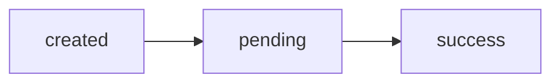
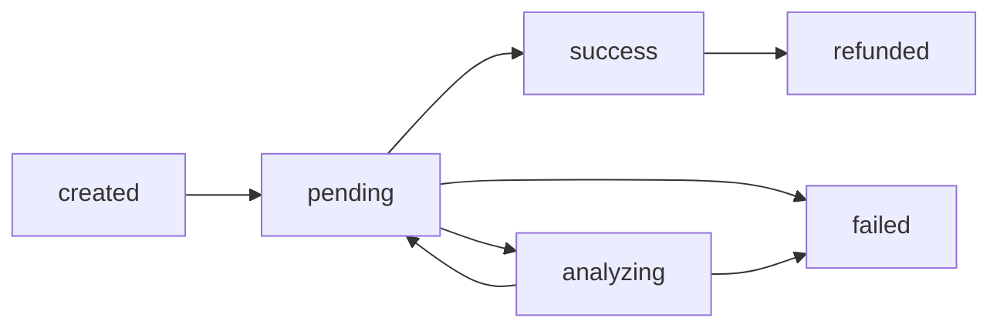
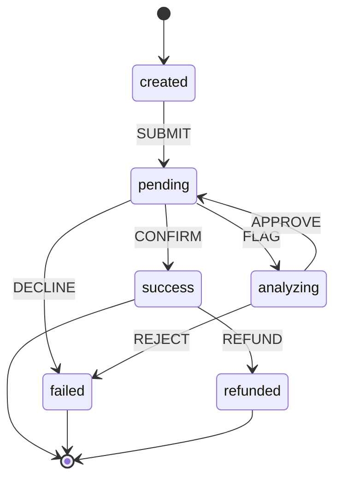
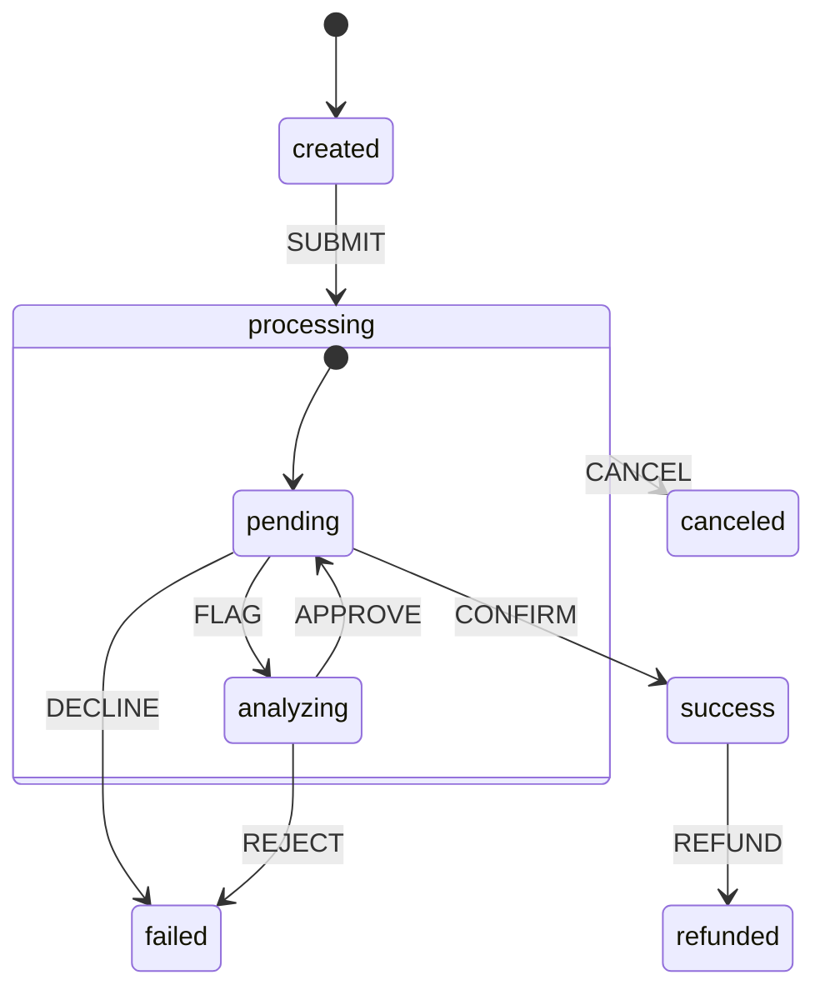

+++
date = '2026-10-18'
draft = false
title = 'Why you should write State Machines'
description = 'Your payment flow rules are spread across every file. Learn how a state machine puts them in one table, kills race conditions, and gives you tests and docs for free.'
toc = true
math = true
+++

Let's say that you have a payments service, and you just received a payment order. This is your workflow:



It seems good, right? The order is created, goes to pending, reaches success, and the customer gets a notification. But real payments are not that simple. The bank can decline it. The gateway can flag it for a manual fraud review (let's call that state `analyzing`), and after the review it goes back to `pending`, sometimes more than once. And a successful payment can be refunded later:



How do you guarantee that, in every case, your code takes the right path? You could answer that you have all the states in mind and your "types" handle it properly, but when you look at your code, the rules of this flow are spread everywhere:

```ts
// webhooks.ts
if (payment.status === "pending" || payment.status === "analyzing") {
    payment.status = "success"
}

// refunds.ts
if (payment.status !== "failed") {
    payment.status = "refunded"
}

// reviews.ts
if (payment.status === "analyzing") {
    payment.status = "pending"
}
```

Can a payment in `analyzing` be confirmed? Can a `pending` payment be refunded? To answer that, you have to open three files and hope there isn't a fourth one.

I will show you a better way to solve this simple problem with a powerful weapon called **state machine**, and you can use it everywhere.

## Why your code is bad

Before fixing anything, let's be honest about how this code usually looks in a real codebase.

If you are modeling it with a bunch of booleans (`isPending`, `isPaid`, `isFailed`...), stop reading here and go fix that first: you are in worse shape than I imagined. Let's assume you are a reasonable person and already have a `status` field.

### Transitions hidden inside cases

First, some context on how a payment actually moves. Your service doesn't decide if a payment succeeds, the payment gateway does (Stripe, Adyen, your bank's API...). After you submit the payment, the gateway tells you what happened by calling an endpoint of yours, a webhook, with an event:

```ts
type GatewayEvent =
    | { type: "payment.confirmed" }                  // the money was captured
    | { type: "payment.flagged" }                    // possible fraud, needs a manual review
    | { type: "payment.declined"; reason: string }   // the card or the bank refused it
```

On our side, the payment is stored with its current status:

```ts
type PaymentStatus = "created" | "pending" | "analyzing" | "success" | "failed" | "refunded"

type Payment = {
    id: string
    amount: number
    status: PaymentStatus
    reason?: string   // only makes sense when failed
    paidAt?: Date     // only makes sense when success or refunded
}
```

The webhook handler is where the status changes. For each event the gateway sends, we update the payment:

```ts
async function handleWebhook(payment: Payment, event: GatewayEvent) {
    switch (event.type) {
        case "payment.confirmed":
            if (payment.status === "pending" || payment.status === "analyzing") {
                payment.status = "success"
                payment.paidAt = new Date()
                await sendNotification(payment)
            }
            break

        case "payment.flagged":
            payment.status = "analyzing"
            break

        case "payment.declined":
            payment.status = "failed"
            payment.reason = event.reason
            break
    }
}
```

And somewhere else in the codebase, an endpoint that refunds the customer:

```ts
async function refund(payment: Payment) {
    if (payment.status !== "failed") {
        payment.status = "refunded"
        await gateway.refund(payment.id)
    }
}
```

It looks clean, it is typed, and the compiler is happy. But look closely, these two small functions already have four bugs:

* **A late `declined` after a `confirmed`** turns a `success` into `failed`. The customer was charged and notified, and now the payment says it failed, while still carrying a `paidAt`.
* **A `flagged` event on a finished payment** sends it back to `analyzing`, no matter if it was `success` or `failed`.
* **`refund` only checks `!== "failed"`**, so you can refund a payment that is still `pending` (and was never charged), or refund the same payment twice.
* **A payment in `analyzing` can be confirmed directly**, skipping the review. Is that allowed? Nobody knows, the rule lives inside an `if`.

> "But my status is a union type, TypeScript protects me."

It protects your states, not your transitions. The compiler knows that `status` is one of six strings, but it has no idea that `failed → success` should never happen. Anyone, anywhere, can write `payment.status = "success"`, and the rules of your business end up scattered across every `case` and `if` in the codebase.

And the optional fields don't help either: nothing stops a `failed` payment from having a `paidAt`, or from missing its `reason`.

### Race conditions

There is one more problem, and this one doesn't show up in your tests. Payment gateways retry webhooks, and sometimes the same event arrives twice, almost at the same time:

```ts
const payment = await db.payments.find(id)      // both requests read "pending"

if (payment.status === "pending") {
    await db.payments.update(id, { status: "success" })
    await sendNotification(payment)              // the customer gets two emails
}
```

Both requests check the status, both see `pending`, and both move on. With a notification it is just annoying, but with a refund it costs real money. Keep this one in mind, we will fix it later.

## What a state machine is

A state machine is a simple idea: your payment is always in exactly one state, and it can only move to another state when an event happens, following rules that you wrote down up front.

We only need three words:

* **State:** where the payment is right now (`pending`).
* **Event:** something that happens to the payment (`CONFIRM`).
* **Transition:** the rule "when I'm in this state and this event happens, I go to that state".

A good way to not mix them up: a state is where you are (`success`), an event is what makes you move (`CONFIRM`).

With these three words, our whole payment flow fits in a table:

| State       | Event     | Next state  |
|-------------|-----------|-------------|
| `created`   | `SUBMIT`  | `pending`   |
| `pending`   | `FLAG`    | `analyzing` |
| `pending`   | `CONFIRM` | `success`   |
| `pending`   | `DECLINE` | `failed`    |
| `analyzing` | `APPROVE` | `pending`   |
| `analyzing` | `REJECT`  | `failed`    |
| `success`   | `REFUND`  | `refunded`  |

And here is the trick: **anything that is not in this table is not allowed**. There is no `failed → success`, no `pending → refunded`, no `analyzing → success`. You don't have to remember to block them, they are blocked by default.

The same table, drawn:



## Building one

Let's turn that table into code, step by step.

### Step 1: the states and the events

We already have the states, they are our `PaymentStatus`. We only need to list the events:

```ts
type PaymentEvent = "SUBMIT" | "FLAG" | "APPROVE" | "REJECT" | "CONFIRM" | "DECLINE" | "REFUND"
```

Notice that not every event comes from the gateway. `CONFIRM`, `FLAG` and `DECLINE` do, through the webhook. The others come from our own system: `SUBMIT` when we send the payment to the gateway, `APPROVE` and `REJECT` when an analyst finishes the fraud review, and `REFUND` when the customer asks for the money back.

One detail about the review: when the gateway flags a payment, it holds the money until we answer. `APPROVE` tells the gateway to go ahead, and the gateway replies with `payment.confirmed`, like any other payment. That's why `APPROVE` goes back to `pending` instead of straight to `success`.

### Step 2: the table

Now we write the table as an object. For each state, which events it accepts and where each one goes:

```ts
const transitions: Record<PaymentStatus, Partial<Record<PaymentEvent, PaymentStatus>>> = {
    created:   { SUBMIT: "pending" },
    pending:   { FLAG: "analyzing", CONFIRM: "success", DECLINE: "failed" },
    analyzing: { APPROVE: "pending", REJECT: "failed" },
    success:   { REFUND: "refunded" },
    failed:    {},
    refunded:  {},
}
```

Compare it with the table above, it's the same thing. `failed` and `refunded` are empty because nothing leaves them, the flow ends there.

### Step 3: the transition function

A small function that looks up the table, and complains if the transition doesn't exist:

```ts
class InvalidTransitionError extends Error {
    constructor(status: string, event: string) {
        super(`cannot ${event} a payment that is ${status}`)
    }
}

function nextState(status: PaymentStatus, event: PaymentEvent): PaymentStatus {
    const next = transitions[status][event]

    if (!next) {
        throw new InvalidTransitionError(status, event)
    }

    return next
}
```

That's the whole state machine. Really, that's it.

### Step 4: using it

Now let's go back to our webhook handler. First, we translate the gateway's events to our events:

```ts
const gatewayEvents: Record<GatewayEvent["type"], PaymentEvent> = {
    "payment.confirmed": "CONFIRM",
    "payment.flagged":   "FLAG",
    "payment.declined":  "DECLINE",
}
```

And the handler stops deciding if the status can change. It just asks the machine:

```ts
async function handleWebhook(payment: Payment, event: GatewayEvent) {
    payment.status = nextState(payment.status, gatewayEvents[event.type])

    if (payment.status === "success") {
        payment.paidAt = new Date()
        await sendNotification(payment)
    }

    if (event.type === "payment.declined") {
        payment.reason = event.reason
    }
}

async function refund(payment: Payment) {
    payment.status = nextState(payment.status, "REFUND")
    await gateway.refund(payment.id)
}
```

The handler still does the work (saving the date, sending the notification, calling the gateway), but the rules now live in one place only: the table. And since `nextState` throws on an invalid transition, nothing after it runs: no notification, no refund. What to answer to the gateway when that happens, we'll see when we talk about retries.

Let's go back to our four bugs:

* **A late `DECLINE` after `CONFIRM`:** `success` doesn't accept `DECLINE`, so `nextState` throws and the payment stays `success`.
* **A `FLAG` on a finished payment:** only `pending` accepts `FLAG`.
* **Refunding a pending payment, or refunding twice:** only `success` accepts `REFUND`. A `pending` payment throws, and so does a payment that is already `refunded`.
* **Confirming during analysis:** `analyzing` doesn't accept `CONFIRM`. And if the business decides it should, it's one line in the table, easy to find and easy to review.

> "And what about the `paidAt` on a failed payment?"

The machine protects the transitions, not the data. If you want that too, you can give each state its own type, so a `failed` payment simply doesn't have a `paidAt` field:

```ts
type Payment =
    | { status: "created" | "pending" | "analyzing"; id: string; amount: number }
    | { status: "success" | "refunded"; id: string; amount: number; paidAt: Date }
    | { status: "failed"; id: string; amount: number; reason: string }
```

It's a nice extra, but not required. The important part is the table.

## The formal definition

What we built has a mathematical name: a **Deterministic Finite Automaton** (DFA). Don't let the name scare you, it is described by five things:

> $M = (Q, \Sigma, \delta, q_0, F)$

* $Q$ is the set of **states**.
    > $Q = \lbrace created,\allowbreak pending,\allowbreak analyzing,\allowbreak success,\allowbreak failed,\allowbreak refunded \rbrace$
* $\Sigma$ is the set of **events** (mathematicians call it the *alphabet*).
    > $\Sigma = \lbrace SUBMIT,\allowbreak FLAG,\allowbreak APPROVE,\allowbreak REJECT,\allowbreak CONFIRM,\allowbreak DECLINE,\allowbreak REFUND \rbrace$
* $\delta$ is the **transition function**: it receives a state and an event, and returns the next state.
    > $\delta : Q \times \Sigma \to Q$
* $q_0$ is the **initial state**, where every payment starts.
    > $q_0 = created$
* $F$ is the set of **final states**, where the flow is allowed to end.
    > $F = \lbrace success,\allowbreak failed,\allowbreak refunded \rbrace$

If you compare it with our code: $Q$ is `PaymentStatus`, $\Sigma$ is `PaymentEvent`, and $\delta$ is `nextState`. For example:

> $\delta(pending, CONFIRM) = success$

And what is $\delta(failed, CONFIRM)$? In the math, $\delta$ needs an answer for every pair of state and event, so they add a special **trap state**: every invalid transition goes there, and nothing ever leaves it. Our code does something different: `nextState` is a **partial function**, it throws instead of answering, and the payment stays where it was. A payment in a trap state would be stuck forever, ours just rejects the event and keeps accepting the valid ones. This detail will matter when we talk about duplicated events.

### Many events in a row

$\delta$ handles one event at a time. When a payment receives several events, we just apply $\delta$ one after the other:

> $created \xrightarrow{SUBMIT} pending \xrightarrow{FLAG} analyzing \xrightarrow{APPROVE} pending \xrightarrow{CONFIRM} success$

Start with an initial value, and apply a function to each item of a list. If you write JavaScript, you already know this pattern, it's a `reduce`:

```ts
const events: PaymentEvent[] = ["SUBMIT", "FLAG", "APPROVE", "CONFIRM"]

const status = events.reduce(nextState, "created") // "success"
```

This line will show up again later.

### Where the side effects fit

A DFA only moves between states, it doesn't *do* anything. When a machine also produces something (like our notification), it's called a **transducer**, and there are two classic kinds:

* **Moore machine:** the output depends only on the state you entered. "When the payment becomes `success`, send a notification". That's our notification: it looks at the new status, not at the event.
* **Mealy machine:** the output depends on the transition. "Send a notification only when going from `analyzing` to `pending`". The `reason` we copy from the `DECLINE` event is closer to this one.

You don't need to memorize the names, but it helps to know that both ways are valid.

## Where it gets even more powerful

### Frontends

How many components have you seen like this?

```tsx
const [isLoading, setIsLoading] = useState(false)
const [error, setError] = useState<Error | null>(null)

async function pay() {
    setIsLoading(true)
    try {
        await api.pay(cart)
    } catch (e) {
        setError(e as Error)
    } finally {
        setIsLoading(false)
    }
}
```

Remember when I said that only someone in really bad shape models state with booleans? On the front end, almost everyone does. The user clicks "pay", gets an error, clicks again: now `isLoading` is `true` and the old error is still on the screen, because nobody cleared it. And if the user double-clicks the button, `pay` runs twice.

Same recipe, smaller table:

```tsx
type PayStatus = "idle" | "paying" | "paid" | "error"
type PayEvent = "PAY" | "SUCCEED" | "FAIL"

const payTransitions: Record<PayStatus, Partial<Record<PayEvent, PayStatus>>> = {
    idle:   { PAY: "paying" },
    paying: { SUCCEED: "paid", FAIL: "error" },
    error:  { PAY: "paying" },
    paid:   {},
}

function reducer(status: PayStatus, event: PayEvent): PayStatus {
    return payTransitions[status][event] ?? status // on the screen, we just ignore invalid events
}

const [status, dispatch] = useReducer(reducer, "idle")

async function pay() {
    if (!payTransitions[status].PAY) return // already paying (or paid), ignore the click

    dispatch("PAY")
    try {
        await api.pay(cart)
        dispatch("SUCCEED")
    } catch {
        dispatch("FAIL")
    }
}
```

Now the screen just reads the status: show the spinner when it's `paying`, show the error when it's `error`. They can't appear together, because the status can't be two things at once. And the double click? While `paying`, the table doesn't accept `PAY`, so the second click returns early and the API is called only once.

Fun fact: the `reducer` you pass to `useReducer` is exactly our $\delta$, a function that receives the current state and an event, and returns the next state. If your flows get bigger (checkouts, multi-step forms, wizards), libraries like [XState](https://stately.ai/docs/xstate) are built around this idea.

### Distributed backends

On the backend, things get interesting when you have more than one process touching the same payment.

#### Fixing the race condition

Remember the two webhooks arriving at the same time? The machine tells us if the transition is valid, and the database makes sure only one request gets to do it. Let's write the confirmation again, now saving it in the database, and add the status we read to the `WHERE`:

```ts
async function confirmPayment(id: string) {
    const payment = await db.payments.find(id)
    const next = nextState(payment.status, "CONFIRM") // throws if not allowed

    const result = await db.query(
        "UPDATE payments SET status = $1, paid_at = now() WHERE id = $2 AND status = $3",
        [next, id, payment.status],
    )

    if (result.rowCount === 0) {
        return // the status changed after we read it, someone else got here first
    }

    await sendNotification({ ...payment, status: next })
}
```

Both requests read `pending`. The first one updates it to `success`. The second one tries `WHERE status = 'pending'`, finds nothing, and stops there. One email, as it should be.

This is called **optimistic locking**: you don't lock anything when reading, you just check, at the moment of writing, that nobody changed the row in the meantime. It's usually done with a `version` column that increases on every update. With a state machine, the status itself can play that role, because `nextState` only looks at the status: if the status is still the one we read, our transition is still valid.

> **Note:** This works because every transition in our table changes the status. If you add transitions that keep the same status (like a `RETRY` that only increments a counter), two requests can pass the same `WHERE`, and one of the updates is lost. In that case, go back to the `version` column.

Also notice the order: first the `UPDATE`, then the notification. If you send the notification (or call the gateway to refund) before saving, both requests do it, and only then one of them fails. By that time, the money is already gone.

This order has a cost too: if the process crashes right after the `UPDATE`, the notification never goes out. Fixing that is the job of the **outbox pattern**, which deserves its own post.

And the retries that arrive later? The payment is already `success`, `success` doesn't accept `CONFIRM`, so `nextState` throws. You catch it, answer `200 OK` to the gateway, and move on. Duplicated events become harmless.

#### Storing the events

Remember the `reduce`? Instead of saving only the current status, you can save every event that happened to the payment, and calculate the status when you need it:

```ts
const events = await db.paymentEvents.findAll(paymentId)
const status = events.reduce(nextState, "created")
```

This is called **event sourcing**. For payments it's great: you get the full history of what happened, and you can answer "what was the status of this payment last Tuesday?" by applying only the events until Tuesday.

One rule: call `nextState` before saving an event, and only save it if it doesn't throw. The list then only has valid events, and the replay never throws.

#### Many servers, same state

This one is my favorite. Databases like etcd and CockroachDB run on several servers that must always agree on the data. The idea behind them is very simple:

> If every server starts at the same state, and applies the same events, in the same order, every server ends up in the same state.

This is called a **replicated state machine**, and it's our `reduce` again, running on each server. Algorithms like **Raft** only make sure all servers agree on the list of events and their order, and each one applies the list on its own.

There is one rule for this to work: the transition function must be deterministic, the D in DFA: it always gives the same answer for the same input. That's why `nextState` only reads the table. The `new Date()`, the notification and the call to the gateway live in the handler, outside of it.

## Testing and documentation for free

Since the rules are just a table, testing them is easy. You can test that the allowed transitions work:

```ts
test("a pending payment can be confirmed", () => {
    expect(nextState("pending", "CONFIRM")).toBe("success")
})
```

And, just as important, that the forbidden ones don't:

```ts
test.each([
    ["failed", "CONFIRM"],
    ["pending", "REFUND"],
    ["refunded", "REFUND"],
] as const)("a %s payment can't receive %s", (status, event) => {
    expect(() => nextState(status, event)).toThrow(InvalidTransitionError)
})
```

With 6 states and 7 events, there are only $6 \times 7 = 42$ combinations. You can literally test all of them.

And the state diagram we drew before? You can generate it from the table, so it never gets outdated:

```ts
function toMermaid(): string {
    const lines = ["stateDiagram-v2", "    [*] --> created"]

    for (const [from, events] of Object.entries(transitions)) {
        for (const [event, to] of Object.entries(events)) {
            lines.push(`    ${from} --> ${to}: ${event}`)
        }
    }

    return lines.join("\n")
}
```

## When not to use it

State machines are not the answer to everything:

* **Simple toggles.** An `isDarkMode` with two states doesn't need a table.
* **Counting things.** A state machine only remembers the current state. If your rule is "fail after 3 retries", don't create `retry_1`, `retry_2` and `retry_3` states. Keep a `retries` counter next to the status, and check it before the transition. This check is called a **guard**, and it works for any data, not only counters. In our flow, say an analyst can only approve small payments on their own:

    ```ts
    async function approve(payment: Payment) {
        if (payment.amount > 10_000) {
            throw new Error("payments above 10k need a second reviewer")
        }

        payment.status = nextState(payment.status, "APPROVE")
        await gateway.approve(payment.id)
    }
    ```

    The guard checks the data, the table checks the state. Keep them apart and the table stays small.
* **Too many states.** If the payment also has a "receipt: pending/sent" and a "fraud check: pending/done" that change independently, a single machine needs every combination: $6 \times 2 \times 2 = 24$ states. That gets out of hand fast.

For that last one, there are **statecharts**, an extension of state machines with two extra ideas:

* **Parallel states:** the receipt and the fraud check get their own small machines, running side by side with the payment. That's $6 + 2 + 2 = 10$ states instead of 24.
* **Nested states:** states inside other states, so you don't have to repeat the same transition everywhere.

Here is the nesting. Imagine the customer can cancel the payment at any moment while it's being processed:



`CANCEL` is drawn from `processing`, so it works from both `pending` and `analyzing`, and you only wrote it once. Everything else is our table as before: `CONFIRM` and `DECLINE` still leave only from `pending`, and `REJECT` only from `analyzing`.

## Key Takeaways

* **One state at a time:** A payment is always in exactly one state.
* **Rules in one place:** All the transitions live in a single table. Anything that is not in the table is not allowed.
* **Small code:** The machine itself is a table and a ten-line function.
* **It's just a reduce:** Applying events one after the other is a `reduce`. That's what powers `useReducer`, event sourcing and replicated databases.
* **Concurrency:** Combine the machine with optimistic locking (a conditional `UPDATE`) to make races and duplicated events harmless.
* **Know the limits:** For counters, use guards. For too many states, use statecharts.

I hope you found this post useful. If you have questions or want to discuss system design, follow me on [socials](https://linkedin.com/in/rodrigobcitadin). Stay safe!
